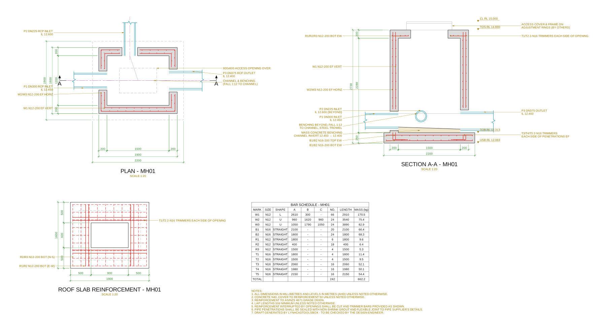
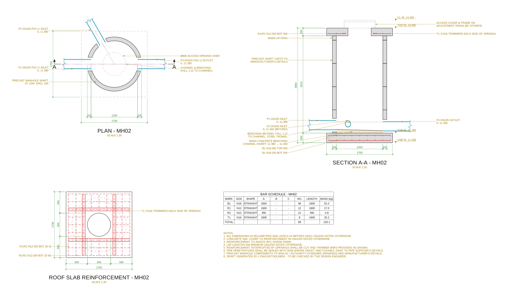
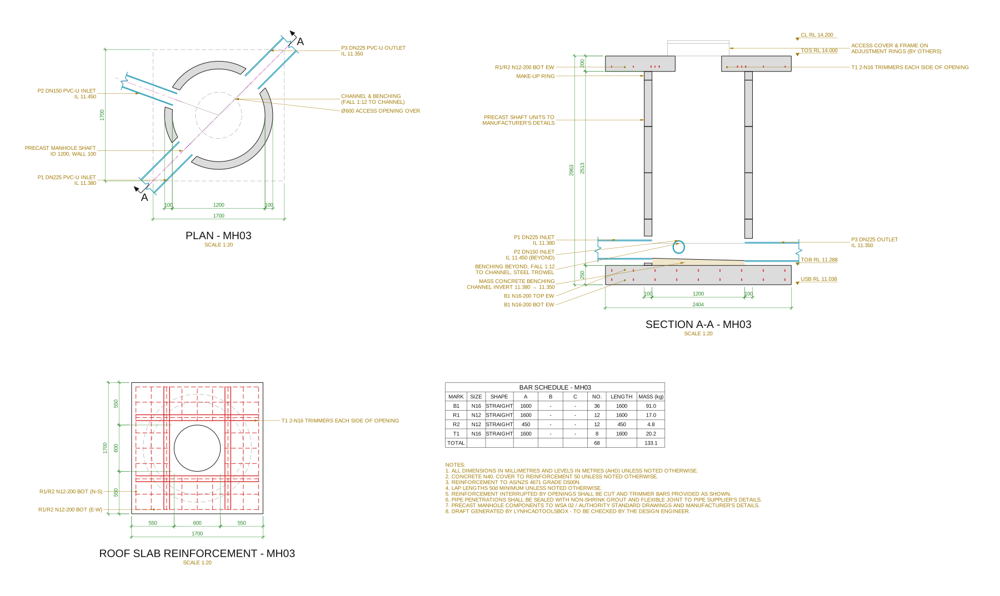

# LynhCadToolsBox

Bộ công cụ C# .NET cho AutoCAD phục vụ triển khai bản vẽ kết cấu thị trường Úc.

Tool đầu tiên: **Manhole Detail**, vẽ tự động chi tiết hố ga BTCT gồm mặt bằng, mặt cắt A-A, mặt bằng thép bản nắp, bảng thống kê thép và ghi chú chung.



| Hố tròn đúc sẵn | Ống ra xiên 45° (mặt cắt xoay theo ống ra) |
|---|---|
|  |  |

> Ảnh trên là preview SVG sinh từ lõi tính toán (không cần AutoCAD). Trong AutoCAD tool vẽ ra entity thật: polyline, hatch, MText, dimension, leader, table, mỗi chi tiết gom thành một Group.

## Tính năng (v0.1)

**Hai loại hố ga**
- *Rectangular cast in-situ*: đáy + tường + nắp BTCT liền khối.
- *Circular precast*: thân đúc sẵn (vẽ mối nối từng đốt), đáy và nắp đổ tại chỗ.

**Bản vẽ sinh ra**
- **PLAN**: cắt qua cao độ ống, tường hatch, lỗ xuyên ống, thép tường (hố chữ nhật), lỗ thăm phía trên và bản đáy phía dưới (nét khuất), tim máng, ký hiệu cắt A-A, kích thước.
- **SECTION A-A**: tự cắt dọc theo trục **ống ra**. Ống bị cắt vẽ dọc, ống phía sau vẽ ellipse đúng phối cảnh, benching và máng, thép bản đáy/nắp/tường (đường và chấm), cao độ CL / TOS / TOB / USB, kích thước.
- **ROOF SLAB REINFORCEMENT**: lưới dưới, thanh bị lỗ thăm cắt, trimmer quanh lỗ.
- **BAR SCHEDULE** (AutoCAD Table) + **NOTES**.

**Thép (AS/NZS 4671 D500N)**
- Tường: thép đứng chân L neo vào đáy; thép ngang 2 thanh U mỗi lớp, nối chồng giữa cạnh ngắn; hai mặt (EF).
- Bản đáy: lưới dưới + lưới trên (tuỳ chọn), hai phương.
- Bản nắp: lưới dưới + lưới trên (tuỳ chọn); thanh bị lỗ thăm cắt được tách và thống kê riêng; trimmer mỗi cạnh lỗ.
- Lỗ ống xuyên tường: trimmer quanh lỗ, hai mặt.
- Tự gộp thanh giống nhau, đánh số hiệu W/B/R/T, ký hiệu kiểu Úc: `W1 N12-200 EF VERT`, `B1/B2 N16-200 BOT EW`.

**Kiểm tra thông số** trước khi vẽ: lỗ ống chồng nhau, ống chạm bản nắp, ống vượt mặt tường, lỗ thăm đè lên tường, thiếu ống ra, invert ống vào thấp hơn ống ra...

## Yêu cầu

- AutoCAD **2021–2024** (Windows x64). Có thể đổi sang 2025+ (.NET 8) sau.
- Visual Studio 2022 hoặc .NET SDK 8 (để build project .NET Framework 4.8).

## Build và cài đặt

```powershell
git clone https://github.com/yeuthantoc/lynhcadtoolsbox.git
cd lynhcadtoolsbox

# Build + tạo bundle trong .\dist
.\build.ps1

# Build + cài bundle tự nạp mỗi lần mở AutoCAD
.\build.ps1 -Install

# Build với API của đúng một bản AutoCAD (2021 / 2022 / 2023 / 2024)
.\build.ps1 -Acad 2023 -Install

# Mạng công ty chặn NuGet? Tham chiếu thẳng DLL trong thư mục cài AutoCAD:
.\build.ps1 -AcadDir "C:\Program Files\Autodesk\AutoCAD 2024"
```

**Cài nhanh cho AutoCAD 2023 (không cần build):** tải [`install-acad2023.ps1`](install-acad2023.ps1), đóng AutoCAD, rồi chạy

```powershell
powershell -ExecutionPolicy Bypass -File .\install-acad2023.ps1             # tải bản mới nhất và cài
powershell -ExecutionPolicy Bypass -File .\install-acad2023.ps1 -Uninstall  # gỡ
```

Bản build mới nhất nằm ở release [`latest`](https://github.com/yeuthantoc/lynhcadtoolsbox/releases/tag/latest); GitHub Actions build lại mỗi lần push lên `main`. Repo private nên script lấy file theo thứ tự: `-Zip <file>` → `LynhCadToolsBox-AutoCAD2023.zip` cạnh script hoặc trong thư mục **Downloads** (tải bằng trình duyệt đã đăng nhập) → tải qua GitHub API bằng `-Token`, `GITHUB_TOKEN` hoặc `gh auth token`. Không có file và không có token thì script mở trang release để bạn tải.

Không muốn cài bundle: trong AutoCAD gõ `NETLOAD` rồi chọn `src\LynhCad.Manhole.Plugin\bin\Release\net48\LynhCad.Manhole.dll`.

## Lệnh

| Lệnh | Mô tả |
|---|---|
| `LCT_MANHOLE` | Mở hộp thoại nhập thông số (3 tab: General / Reinforcement / Pipes), bấm **Draw**, chọn điểm đặt (tâm hố trên mặt bằng). Tool nhớ thông số lần trước. |
| `LCT_MANHOLE_JSON` | Vẽ từ file JSON. File có thể chứa **một** hố `{...}` hoặc **nhiều** hố `[{...}, {...}]`. Nhiều hố sẽ xếp cạnh nhau từ trái sang phải. |
| `LCT_MANHOLE_EDIT` | **Cập nhật chi tiết đã vẽ.** Chọn một đối tượng bất kỳ của chi tiết, hộp thoại mở với thông số cũ, sửa rồi bấm **Update**: chi tiết cũ bị xoá và vẽ lại đúng chỗ (kể cả khi đã MOVE). |

### Cập nhật bản vẽ

Mỗi chi tiết là một **Group** (không phải block) tên `LCT_<mã hố>`. Thông số hố ga được lưu ngay trong group (trong file DWG), nên mở lại bản vẽ trên máy khác vẫn sửa được.

1. Gõ `LCT_MANHOLE_EDIT`, chọn một nét bất kỳ của chi tiết.
2. Sửa thông số (kích thước, thép, ống...) rồi bấm **Update**.
3. Muốn huỷ: `U` (một lần undo là về như cũ).

Lưu ý:
- Mọi chỉnh sửa tay trên các đối tượng của chi tiết sẽ mất khi Update. Ghi chú thêm tay thì vẽ ngoài group (không bị xoá).
- Chi tiết vẽ bằng v0.1, hoặc đã `EXPLODE`/`UNGROUP`, không còn thông số: xoá đi và vẽ lại bằng `LCT_MANHOLE`.
- Chỉ theo được lệnh MOVE; nếu đã ROTATE/SCALE chi tiết thì Update sẽ vẽ lại ở hướng/tỉ lệ gốc.

Hộp thoại có nút **Load JSON / Save JSON** để lưu cấu hình chuẩn của dự án, và 2 mẫu có sẵn để thử nhanh.

## Quy ước

- Đơn vị: kích thước **mm**, cao độ **m (AHD)**. Vẽ 1:1 trong model space, chữ và dim theo tỉ lệ `scale` (mặc định 1:20).
- Mặt bằng: X = Đông, Y = Bắc, tâm hố tại điểm chọn.
- Hố chữ nhật: ống khai báo theo **tường** (`North/East/South/West`) + **offset** dọc tường so với tim hố. Ống vuông góc tường.
- Hố tròn: ống khai báo theo **góc** (0° = +X, ngược chiều kim đồng hồ), hướng tâm.
- **Mặt bản đáy** = đáy ngoài thấp nhất của các ống − `sumpDepth`. **Mặt bản nắp** = `coverLevel` − `coverAllowance`.
- **Mặt cắt A-A** luôn đi dọc trục ống ra (ống ra nằm bên phải), nhìn về phía trái của hướng ống ra.

## File thông số JSON

Ví dụ đầy đủ trong [`samples/`](samples). Trường bị thiếu sẽ lấy giá trị mặc định.

```json
{
  "id": "MH01",
  "type": "RectangularCast",
  "internalLength": 1500, "internalWidth": 1200, "wallThickness": 200,
  "baseThickness": 250, "baseProjection": 150, "roofThickness": 200,
  "openingX": 900, "openingY": 600,
  "coverLevel": 15.000, "coverAllowance": 200, "sumpDepth": 50,
  "cover": 50,
  "wallVertical": { "dia": 12, "spacing": 200 },
  "wallHorizontal": { "dia": 12, "spacing": 200 },
  "baseBottom": { "dia": 16, "spacing": 200 }, "baseTopMat": true,
  "roofBottom": { "dia": 12, "spacing": 200 }, "roofTopMat": false,
  "trimmerDia": 16, "trimmerCount": 2, "lapFactor": 50,
  "pipes": [
    { "mark": "P1", "role": "Inlet",  "dn": 300, "od": 360, "il": 12.450, "wall": "West" },
    { "mark": "P3", "role": "Outlet", "dn": 375, "od": 450, "il": 12.400, "wall": "East" }
  ]
}
```

Hố tròn: `"type": "CircularPrecast"`, dùng `internalDiameter`, `precastWallThickness`, `ringHeight`, `openingDiameter`, `roofProjection`, và ống dùng `"angle"` thay cho `wall/offset`.

## Cấu trúc mã nguồn

```
src/LynhCad.Manhole.Core      netstandard2.0, KHÔNG phụ thuộc AutoCAD
  Model/      ManholeParams (thông số), ManholeGeometry (kích thước suy ra + kiểm tra), ParamsJson
  Rebar/      RebarDesigner (bố trí thép), RebarSchedule (gộp & đánh số hiệu), khối lượng AS/NZS 4671
  Geometry/   Vec2, Interval, union đường bao, rải thanh...
  Drawing/    PlanBuilder, SectionBuilder, RoofPlanBuilder, ScheduleBuilder, DetailComposer
              → sinh "primitive" trung gian (polyline, hatch, text, dim, leader, table)
  Export/     SvgExporter (preview / kiểm tra không cần AutoCAD)
src/LynhCad.Manhole.Plugin    net48 + WPF, plugin AutoCAD
  Commands.cs     lệnh LCT_MANHOLE, LCT_MANHOLE_JSON, LCT_MANHOLE_EDIT; lưu thông số vào group
  AcadSetup.cs    layer S-*, linetype, text style, dim style LCT_1-20
  AcadRenderer.cs primitive → entity AutoCAD
  UI/             hộp thoại WPF
tools/LynhCad.Manhole.Preview  CLI: chạy bộ kiểm tra, xuất SVG từ JSON
deploy/                        PackageContents.xml cho bundle tự nạp
```

Lõi tách khỏi AutoCAD nên logic có thể test và xem trước ở bất kỳ đâu:

```bash
dotnet run --project tools/LynhCad.Manhole.Preview -- check
dotnet run --project tools/LynhCad.Manhole.Preview -- svg samples/rect-mh01.json out.svg
```

## Giới hạn hiện tại (v0.1)

- **Tool KHÔNG tính toán kết cấu.** Đường kính và khoảng cách thép do người dùng nhập. Bố trí là quy tắc detailing thông dụng, đã đơn giản hoá. Bản vẽ cần kỹ sư thiết kế kiểm tra (đã ghi trong notes).
- Hố chữ nhật: ống phải vuông góc tường.
- Thép tường tại lỗ ống: thống kê thanh nguyên (cắt tại chỗ) + trimmer, chưa tách thanh ngắn.
- Lỗ thăm tròn: thanh bản nắp cắt theo hình vuông bao quanh lỗ.
- Chưa có: bậc thang (step irons), chi tiết khung nắp, hố sâu nhiều đoạn, mặt cắt B-B, layer/style theo template công ty.

## Lộ trình

- [ ] Mặt cắt B-B vuông góc, step irons, chi tiết benching/máng
- [ ] Đọc template công ty (layer, dim style, title block)
- [ ] Nhập danh sách hố ga từ Excel
- [ ] Hỗ trợ AutoCAD 2025+ (.NET 8)
