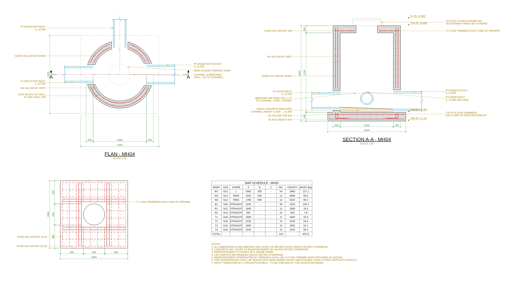

# LynhCadToolsBox

Bộ công cụ C# .NET cho AutoCAD phục vụ triển khai bản vẽ kết cấu thị trường Úc.

Tool đầu tiên: **Manhole Detail**, vẽ tự động chi tiết hố ga BTCT gồm mặt bằng, mặt cắt A-A, mặt bằng thép bản nắp, bảng thống kê thép và ghi chú chung.


| Hố tròn đúc sẵn | Ống ra xiên 45° (mặt cắt xoay theo ống ra) |
|---|---|
|  |  |

| Hố tròn BTCT đổ tại chỗ |
|---|
|  |

> Ảnh trên là preview SVG sinh từ lõi tính toán (không cần AutoCAD). Trong AutoCAD tool vẽ ra entity thật: polyline, hatch, MText, dimension (RotatedDimension, dim style `LCT_1-20`), multileader (MLeader), block có attribute cho ký hiệu cao độ (`LCT_LEVEL`, attribute `LEVEL`) và ký hiệu cắt (`LCT_SECTION`, attribute `LETTER`), table, mỗi chi tiết gom thành một Group.

## Tính năng (v0.1)

**Ba loại hố ga**
- *Rectangular cast in-situ* (`RectangularCast`): đáy + tường + nắp BTCT liền khối.
- *Circular precast* (`CircularPrecast`): thân đúc sẵn (vẽ mối nối từng đốt), đáy và nắp đổ tại chỗ.
- *Circular cast in-situ* (`CircularCast`): đáy + tường tròn + nắp BTCT liền khối, tường có thép hai mặt.

**Bản vẽ sinh ra**
- **PLAN**: cắt qua cao độ ống, tường hatch, lỗ xuyên ống, thép tường (hố đổ tại chỗ), lỗ thăm phía trên và bản đáy phía dưới (nét khuất), tim máng, ký hiệu cắt A-A, kích thước.
- **SECTION A-A**: tự cắt dọc theo trục **ống ra**. Ống bị cắt vẽ dọc, ống phía sau vẽ ellipse đúng phối cảnh, benching và máng, thép bản đáy/nắp/tường (đường và chấm), cao độ CL / TOS / TOB / USB, kích thước.
- **ROOF SLAB REINFORCEMENT**: lưới dưới, thanh bị lỗ thăm cắt, trimmer quanh lỗ.
- **BAR SCHEDULE** (AutoCAD Table) + **NOTES**.
- **Bậc thang (step irons)**, tuỳ chọn: một hàng bậc trên mặt trong tường, tự đặt dưới lỗ thăm và tránh lỗ ống (hoặc chỉ định góc). Mặt bằng vẽ hình chữ U; mặt cắt vẽ nhìn nghiêng (tường bị cắt) hoặc chính diện (tường phía sau); thêm ghi chú. Layer `S-STEP`.

**Thép (AS/NZS 4671 D500N)**
- Tường đổ tại chỗ: thép đứng chân L neo vào đáy, hai mặt (EF). Thép ngang: hố chữ nhật 2 thanh U mỗi lớp, nối chồng giữa cạnh ngắn; hố tròn 1 vòng kín mỗi lớp (`RING` trong bảng: A = đường kính tim vòng, B = chiều dài nối chồng).
- Bản đáy: lưới dưới + lưới trên (tuỳ chọn), hai phương.
- Bản nắp: lưới dưới + lưới trên (tuỳ chọn); thanh bị lỗ thăm cắt được tách và thống kê riêng; trimmer mỗi cạnh lỗ.
- Lỗ ống xuyên tường: trimmer quanh lỗ, hai mặt.
- Tự gộp thanh giống nhau, đánh số hiệu W/B/R/T, ký hiệu kiểu Úc: `W1 N12-200 EF VERT`, `B1/B2 N16-200 BOT EW`.

**Kiểm tra thông số** trước khi vẽ: lỗ ống chồng nhau, ống chạm bản nắp, ống vượt mặt tường, lỗ thăm đè lên tường, thiếu ống ra, invert ống vào thấp hơn ống ra...

## Yêu cầu

- AutoCAD **2021–2024** (Windows x64). Có thể đổi sang 2025+ (.NET 8) sau.
- Visual Studio 2022 hoặc .NET SDK 8 (để build project .NET Framework 4.8).

## Build và cài đặt

```powershell
git clone https://github.com/yeuthantoc/lynhcadtoolsbox.git
cd lynhcadtoolsbox

# Build + tạo bundle trong .\dist
.\build.ps1

# Build + cài bundle tự nạp mỗi lần mở AutoCAD
.\build.ps1 -Install

# Build với API của đúng một bản AutoCAD (2021 / 2022 / 2023 / 2024)
.\build.ps1 -Acad 2023 -Install

# Mạng công ty chặn NuGet? Tham chiếu thẳng DLL trong thư mục cài AutoCAD:
.\build.ps1 -AcadDir "C:\Program Files\Autodesk\AutoCAD 2024"
```

**Cài nhanh cho AutoCAD 2023 (không cần build).** Mở PowerShell, chạy:

```powershell
powershell -ExecutionPolicy Bypass -Command "iwr https://raw.githubusercontent.com/yeuthantoc/lynhcadtoolsbox/main/install-acad2023.ps1 -OutFile $env:TEMP\install-acad2023.ps1 -UseBasicParsing; & $env:TEMP\install-acad2023.ps1"
```

Hoặc tải [`install-acad2023.ps1`](install-acad2023.ps1) rồi chạy `powershell -ExecutionPolicy Bypass -File .\install-acad2023.ps1` (thêm `-Uninstall` để gỡ, `-Zip <file>` để cài từ file zip có sẵn). Script tải bản mới nhất ở release [`latest`](https://github.com/yeuthantoc/lynhcadtoolsbox/releases/tag/latest); GitHub Actions build lại release này mỗi lần push lên `main`.

Không muốn cài bundle: trong AutoCAD gõ `NETLOAD` rồi chọn `src\LynhCad.Loader\bin\Release\net48\LynhCad.Loader.dll` và đặt biến môi trường `LYNHCAD_PLUGIN_DIR` = `<repo>\src\LynhCad.Manhole.Plugin\bin\Release\net48` (trước khi mở AutoCAD).

### Cập nhật không cần mở lại AutoCAD

AutoCAD chỉ nạp `LynhCad.Loader.dll`. Loader đọc `LynhCad.Manhole.dll` và `LynhCad.Manhole.Core.dll` vào bộ nhớ, nên file không bị khoá:

1. Để AutoCAD mở, chạy `.\build.ps1 -Acad 2023 -Install` (hoặc `install-acad2023.ps1`) để chép đè bản mới.
2. Chạy lại lệnh (`LCT_MANHOLE`...): loader thấy DLL mới hơn và tự nạp. Gõ `LCT_RELOAD` để nạp ngay.

Lưu ý: mỗi lần nạp lại, bản cũ vẫn chiếm RAM đến khi đóng AutoCAD (vài MB, không sao khi phát triển). Bản thân `LynhCad.Loader.dll` vẫn bị khoá; nó ít khi đổi, khi đổi thì phải đóng AutoCAD rồi cài lại. Lần đầu nâng cấp từ bản chưa có loader cũng phải đóng AutoCAD.

## Lệnh

| Lệnh | Mô tả |
|---|---|
| `LCT_MANHOLE` | Mở hộp thoại nhập thông số (3 tab: General / Reinforcement / Pipes), bấm **Draw**, chọn điểm đặt (tâm hố trên mặt bằng). Tool nhớ thông số lần trước. |
| `LCT_MANHOLE_JSON` | Vẽ từ file JSON. File có thể chứa **một** hố `{...}` hoặc **nhiều** hố `[{...}, {...}]`. Nhiều hố sẽ xếp cạnh nhau từ trái sang phải. |
| `LCT_RELOAD` | Nạp lại DLL plugin mới (sau khi build/cài đè) mà không cần mở lại AutoCAD. |
| `LCT_MANHOLE_EDIT` | **Cập nhật chi tiết đã vẽ.** Chọn một đối tượng bất kỳ của chi tiết, hộp thoại mở với thông số cũ, sửa rồi bấm **Update**: chi tiết cũ bị xoá và vẽ lại đúng chỗ (kể cả khi đã MOVE). |

### Cập nhật bản vẽ

Mỗi chi tiết là một **Group** (không phải block) tên `LCT_<mã hố>`. Thông số hố ga được lưu ngay trong group (trong file DWG), nên mở lại bản vẽ trên máy khác vẫn sửa được.

1. Gõ `LCT_MANHOLE_EDIT`, chọn một nét bất kỳ của chi tiết.
2. Sửa thông số (kích thước, thép, ống...) rồi bấm **Update**.
3. Muốn huỷ: `U` (một lần undo là về như cũ).

Lưu ý:
- Mọi chỉnh sửa tay trên các đối tượng của chi tiết sẽ mất khi Update. Ghi chú thêm tay thì vẽ ngoài group (không bị xoá).
- Chi tiết vẽ bằng v0.1, hoặc đã `EXPLODE`/`UNGROUP`, không còn thông số: xoá đi và vẽ lại bằng `LCT_MANHOLE`.
- Chỉ theo được lệnh MOVE; nếu đã ROTATE/SCALE chi tiết thì Update sẽ vẽ lại ở hướng/tỉ lệ gốc.

Hộp thoại có nút **Load JSON / Save JSON** để lưu cấu hình chuẩn của dự án, và 3 mẫu có sẵn để thử nhanh (Rectangular, Circular precast, Circular cast).

## Quy ước

- Đơn vị: kích thước **mm**, cao độ **m (AHD)**. Vẽ 1:1 trong model space, chữ và dim theo tỉ lệ `scale` (mặc định 1:20).
- Mặt bằng: X = Đông, Y = Bắc, tâm hố tại điểm chọn.
- Hố chữ nhật: ống khai báo theo **tường** (`North/East/South/West`) + **offset** dọc tường so với tim hố. Ống vuông góc tường.
- Hố tròn: ống khai báo theo **góc** (0° = +X, ngược chiều kim đồng hồ), hướng tâm.
- Tab Pipes: **DN**, **OD** và **Material** chọn từ danh sách (hoặc gõ giá trị khác). Đổi DN / vật liệu thì OD tự điền theo danh mục (`PipeCatalog`: PVC-U AS/NZS 1260, PE100, DICL; vật liệu khác OD ≈ 1.2·DN) — chỉ là giá trị gợi ý, cần kiểm tra theo catalogue nhà sản xuất.
- **Mặt bản đáy** = đáy ngoài thấp nhất của các ống − `sumpDepth`. **Mặt bản nắp** = `coverLevel` − `coverAllowance`.
- **Cog và đường kính uốn**: mặc định `"cogs": true` — thanh lưới bản đáy / bản nắp có cog chuẩn 90° (AS 3600 13.1.2.7) ở hai đầu (lớp dưới móc lên, lớp trên móc xuống, rút ngắn khi bản mỏng để không vượt lớp đối diện); thép đứng tường chân L vào đáy + cog vào bản nắp (thanh chữ U: A = chân, B = đoạn đứng, C = cog). `bendFactor` (5) = đường kính trong chỗ uốn tính theo d (AS 3600 Bảng 17.2.3.2); mọi chỗ uốn (chân, cog, góc thanh U, chỗ gãy) vẽ cung đúng bán kính tim và chiều dài cắt trong bảng đã trừ phần uốn. Bảng thống kê có cột `COG` (vd `2x170`, `1x170`, `170+120`) và cột `D`; kích thước A–D đo theo tim thanh. Thanh gia cường và vòng tròn không có cog. Để cog không đè lên nhau: lưới trên lùi đầu thanh 10 mm so với lưới dưới (mép bản và mép lỗ thăm), thép đứng mặt ngoài có chân L cao hơn và cog thấp hơn mặt trong 10 mm (nên mặt trong / mặt ngoài là hai mác, vd `W1/W2`). Dưới rãnh khung nắp, thanh vuông góc chỉ hạ từ chỗ lớp kia bắt đầu gãy và hạ dần theo đoạn xiên.
- **Rãnh khung nắp** (`coverRebate`): mặt bản nắp hạ xuống `coverRebateDepth` trong phạm vi lỗ thăm + `coverRebateWidth` mỗi phía (hố tròn: rãnh tròn); khung nắp vẽ đặt trong rãnh. Lưới thép **trên** của bản nắp và thanh gia cường lớp trên nằm trong phạm vi rãnh được **nhấn xuống** bằng đúng chiều sâu rãnh (đoạn xiên dốc 1:2), thống kê thành thanh `CRANKED` (gãy một chỗ: A, B = độ nhấn, C) hoặc `DROPPED` (nhấn ở giữa: A, B, C, D — bảng có thêm cột D). Lưới dưới không đổi.
- **Mặt cắt A-A** luôn đi dọc trục ống ra (ống ra nằm bên phải), nhìn về phía trái của hướng ống ra.
- **Bảng hình dạng thép** (`BAR SHAPES`, bên phải bảng thống kê): mỗi số hiệu một ô gồm mác, đường kính, số thanh, chiều dài cắt và hình dạng thanh (chỗ uốn bo cung, không theo tỉ lệ) với kích thước ghi trực tiếp lên từng đoạn: A/B/C/D, chân cog, Ø vòng và nối chồng.
- **Leader chỉ vào nét ngang** (thanh lưới, ống, mặt rãnh, benching): chữ đặt thấp hơn điểm đặt ≥ 2 chiều cao chữ để leader vào xiên 45° (hoặc đứng), không trùng hướng nét. Ghi chú lưới chỉ vào giữa đoạn thẳng của thanh, tránh cog và chỗ gãy. Đầu ống có nét đóng tại mặt trong tường; benching là bê tông khối: đường bao kín + hatch AR-CONC.
- **Đầu leader**: mặc định mũi tên; chỉ vào chấm thép (thanh cắt ngang trên mặt cắt, thép đứng trên mặt bằng) thì vòng tròn rỗng (AutoCAD `_DOTBLANK`) và luôn chỉ đúng vào một chấm; chỉ vào vùng hatch (bê tông tường, benching) thì vòng tròn đặc (`_DOT`).
- **Thép ngang tường**: hai thanh U mỗi vòng đặt cách nhau ≥ 10 mm ở vùng nối chồng (thanh thứ hai về phía tim tường, và cũng cách thép đứng ≥ 10 mm, sang bên kia thép đứng nếu cần; trên mặt cắt là hai chấm cạnh nhau), cùng một mác. Lỗ ống cắt đứt vùng nối chồng trên tường nào thì tường đó không còn lap: hai chân thanh U dừng tại lỗ ống, nằm đúng vị trí vòng, mẩu ngắn hơn 300 mm ở đầu nối chồng không vẽ. Thanh vuông góc đầu tiên / cuối cùng của lưới và thanh sát lỗ thăm nằm trong vùng cog của lớp kia (cách tim cog 1,5d + 10).
- **Ghi chú (callout)**: xếp thành cột hai bên hình, cách nhau ≥ 1.2 × chiều cao chữ; leader ngang khi chữ cùng cao độ với điểm đặt, nếu phải dời chữ thì gãy khúc 45° (hoặc 90°) tính từ điểm đặt rồi landing ngang; các leader không cắt nhau và giữ khoảng trống 1.2 × chiều cao chữ với số kích thước / nhãn cao độ. Mặt bằng thép bản nắp đặt thẳng tim dưới mặt bằng.

## File thông số JSON

Ví dụ đầy đủ trong [`samples/`](samples). Trường bị thiếu sẽ lấy giá trị mặc định.

```json
{
  "id": "MH01",
  "type": "RectangularCast",
  "internalLength": 1500, "internalWidth": 1200, "wallThickness": 200,
  "baseThickness": 250, "baseProjection": 150, "roofThickness": 200,
  "openingX": 900, "openingY": 600,
  "coverRebate": false, "coverRebateDepth": 50, "coverRebateWidth": 150,
  "coverLevel": 15.000, "coverAllowance": 200, "sumpDepth": 50,
  "cover": 50,
  "wallVertical": { "dia": 12, "spacing": 200 },
  "wallHorizontal": { "dia": 12, "spacing": 200 }, "wallSingleLayer": false, "wallHorizontalInside": false,
  "baseBottom": { "dia": 16, "spacing": 200 }, "baseTopMat": true,
  "roofBottom": { "dia": 12, "spacing": 200 }, "roofTopMat": false,
  "trimmerDia": 16, "trimmerCount": 2, "lapFactor": 50, "cogs": true, "bendFactor": 5,
  "pipes": [
    { "mark": "P1", "role": "Inlet",  "dn": 300, "od": 360, "il": 12.450, "wall": "West" },
    { "mark": "P3", "role": "Outlet", "dn": 375, "od": 450, "il": 12.400, "wall": "East" }
  ]
}
```

Hố tròn đúc sẵn: `"type": "CircularPrecast"`, dùng `internalDiameter`, `precastWallThickness`, `ringHeight`, `openingDiameter`, `roofProjection`, và ống dùng `"angle"` thay cho `wall/offset`.

Thép tường: mặc định 2 lớp hai mặt (EF); `"wallSingleLayer": true` đặt 1 lớp giữa tường (ký hiệu CENTRAL). Mặc định thép ngang là lớp ngoài (sát mặt bê tông), thép đứng phía trong; `"wallHorizontalInside": true` đảo lại (thép đứng ngoài, thép ngang buộc phía trong). Thanh đứng ở các mặt luôn thẳng hàng với nhau (cùng vị trí dọc tường / cùng góc).

Rãnh khung nắp: `"coverRebate": true`, `coverRebateDepth` (50, ≥ 20 và bản nắp còn lại ≥ 100), `coverRebateWidth` (150, rộng hơn lỗ thăm mỗi phía, ≥ `cover`). Có lưới trên thì chiều sâu bị giới hạn để lưới trên nhấn xuống vẫn cách lưới dưới ≥ 25 mm. Ví dụ: [`samples/rect-mh05-rebate.json`](samples/rect-mh05-rebate.json), [`samples/circ-cast-mh06-rebate.json`](samples/circ-cast-mh06-rebate.json).

Bậc thang: `"stepIrons": true`, tuỳ chọn `stepSpacing` (300), `stepWidth` (350), `stepProjection` (150), `stepTopGap` (300, từ đáy bản nắp tới bậc trên cùng), `stepBottomClear` (300, bậc dưới cùng trên mặt benching), `stepAuto` (true) hoặc `"stepAuto": false` + `stepAngle` (độ, hướng từ tâm hố tới tường đặt bậc, 0° = +X).

Hố tròn đổ tại chỗ: `"type": "CircularCast"`, dùng `internalDiameter`, `wallThickness` (≥ 150), `openingDiameter`, `roofProjection`, thép tường `wallVertical` / `wallHorizontal`, và ống dùng `"angle"`. Ví dụ: [`samples/circ-cast-mh04.json`](samples/circ-cast-mh04.json).

## Cấu trúc mã nguồn

```
src/LynhCad.Manhole.Core      netstandard2.0, KHÔNG phụ thuộc AutoCAD
  Model/      ManholeParams (thông số), ManholeGeometry (kích thước suy ra + kiểm tra), ParamsJson
  Rebar/      RebarDesigner (bố trí thép), RebarSchedule (gộp & đánh số hiệu), khối lượng AS/NZS 4671
  Geometry/   Vec2, Interval, union đường bao, rải thanh...
  Drawing/    PlanBuilder, SectionBuilder, RoofPlanBuilder, ScheduleBuilder, DetailComposer
              → sinh "primitive" trung gian (polyline, hatch, text, dim, leader, table)
  Export/     SvgExporter (preview / kiểm tra không cần AutoCAD)
src/LynhCad.Loader            net48, DLL AutoCAD nạp: đăng ký lệnh, nạp/nạp lại plugin từ byte
src/LynhCad.Manhole.Plugin    net48 + WPF, plugin AutoCAD (gọi qua Entry.Run, không tự đăng ký lệnh)
  Entry.cs        điểm vào Entry.Run (loader gọi qua reflection)
  Commands.cs     lệnh LCT_MANHOLE, LCT_MANHOLE_JSON, LCT_MANHOLE_EDIT
  DetailData.cs   lưu / đọc thông số trong Xrecord của group
  AcadSetup.cs    layer S-*, linetype, text style, dim style LCT_1-20
  AcadRenderer.cs primitive → entity AutoCAD
  UI/             hộp thoại WPF
tools/LynhCad.Manhole.Preview  CLI: chạy bộ kiểm tra, xuất SVG từ JSON
deploy/                        PackageContents.xml cho bundle tự nạp
```

Lõi tách khỏi AutoCAD nên logic có thể test và xem trước ở bất kỳ đâu:

```bash
dotnet run --project tools/LynhCad.Manhole.Preview -- check
dotnet run --project tools/LynhCad.Manhole.Preview -- svg samples/rect-mh01.json out.svg
```

## Giới hạn hiện tại (v0.1)

- **Tool KHÔNG tính toán kết cấu.** Đường kính và khoảng cách thép do người dùng nhập. Bố trí là quy tắc detailing thông dụng, đã đơn giản hoá. Bản vẽ cần kỹ sư thiết kế kiểm tra (đã ghi trong notes).
- Hố chữ nhật: ống phải vuông góc tường.
- Thép tường tại lỗ ống: thống kê thanh nguyên (cắt tại chỗ) + trimmer, chưa tách thanh ngắn.
- Lỗ thăm tròn: thanh bản nắp cắt theo hình vuông bao quanh lỗ.
- Bậc thang: một hàng thẳng đứng; vị trí tự động chỉ xét lỗ thăm và lỗ ống (không xét máng giữa hố). Trên mặt cắt, bậc ở tường phía trước mặt cắt không thể hiện.
- Chưa có: chi tiết khung nắp, hố sâu nhiều đoạn, mặt cắt B-B, layer/style theo template công ty.

## Lộ trình

- [ ] Mặt cắt B-B vuông góc, step irons, chi tiết benching/máng
- [ ] Đọc template công ty (layer, dim style, title block)
- [ ] Nhập danh sách hố ga từ Excel
- [ ] Hỗ trợ AutoCAD 2025+ (.NET 8)
